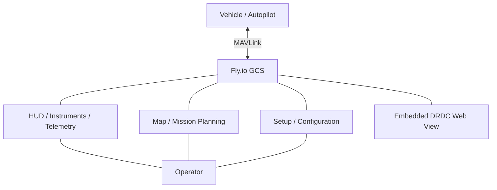

<p align="center">
  
</p>

<p align="center">
  
  &nbsp;&nbsp;&nbsp;
  
</p>

# FLY.IO GCS

**Ground Control Station for UAV and UGV Systems**

Mission Planning | Telemetry | Vehicle Configuration | Simulation | DRDC Integration

**Native Windows desktop** &nbsp;|&nbsp; **.NET Framework 4.7.2** &nbsp;|&nbsp; **Active Development**

[Overview](#project-overview) · [Quick Start](#quick-start) · [Interface](#flyio-gcs-interface) · [Build and Run](#build-and-run) · [Troubleshooting](#troubleshooting)

## Technology & Platforms

### Platforms

|  |  |  |
| --- | --- | --- |
| **Windows 10/11** | **Linux** | **macOS** |
| Native / Recommended | Development / source workflow only | Development / source workflow only |
| Windows desktop application | Not currently a native Linux release | Not currently a native macOS release |

### Core Technology

|  C# |  .NET Framework 4.7.2 | Windows Forms | MAVLink |
| --- | --- | --- | --- |
| Application language | Desktop build target: `net472` | Windows desktop interface | Vehicle communication protocol |

### Development Tools

|  |  |  |  |
| --- | --- | --- | --- |
| **Visual Studio** | **Visual Studio Code** | **PowerShell** | **Git** |
| Windows IDE option | Source editor option | Windows command workflow | Source version control |

### Repository / Collaboration

|  GitHub |  GitLab |
| --- | --- |
| Public project repository | Internal team collaboration |

### Vehicle / GCS Ecosystem

| ArduPilot | PX4 | QGroundControl |
| --- | --- | --- |
| Mission Planner heritage and vehicle ecosystem | Development/testing context only | Separate GCS |
| Vehicle-specific compatibility must be validated | Not required to run Fly.io GCS | Not part of Fly.io GCS |

VS Code allows source-code development but does **not** make the WinForms application native on Linux or macOS. Logos identify relevant tools and platforms; they do not indicate a passed build, certified compatibility, or endorsement. [Logo sources and attribution](Assets/README/ATTRIBUTION.md).

## Project Overview

Fly.io GCS is a customized and extended Windows desktop Ground Control Station built on the Mission Planner ecosystem, with a Fly.io-specific interface and project functionality. It supports UAV and UGV workflows where compatible with the connected vehicle, including vehicle telemetry, mission planning, mapping, configuration, simulation/testing, logs, vehicle connection, and DRDC/Fly.io project integration.

Fly.io GCS originated from the ArduPilot Mission Planner codebase. It retains inherited components, namespaces, and internal project identifiers; the product was not written entirely from scratch. Function availability depends on the connected vehicle, autopilot, and configuration.

## Current Release

| Item | Current repository configuration |
| --- | --- |
| Product | Fly.io GCS |
| Status | Active Development |
| Executable | `Fly.io-GCS.exe` |
| Primary OS | Windows 10/11 64-bit |
| Build target | .NET Framework 4.7.2 / `net472` |
| Historical output directory | `bin\Release\net461` |

`net461` is the historical output folder name; the project targets `net472`. No release version or release date is asserted here. Obtain the approved package and its version/commit from the team.

## Fly.io GCS Interface

Seven primary areas, shown using the actual Fly.io navigation artwork already used by the project. These illustrations identify the workspaces; they are not screenshots or generated interface mockups.

<table>
<tr>
<td align="center" width="50%"><br><strong>DATA</strong><br>Real-Time Monitoring</td>
<td align="center" width="50%"><br><strong>PLAN</strong><br>Mission Planning</td>
</tr>
<tr>
<td align="center" width="50%"><br><strong>SETUP</strong><br>Vehicle Setup</td>
<td align="center" width="50%"><br><strong>CONFIG</strong><br>Configuration</td>
</tr>
<tr>
<td align="center" width="50%"><br><strong>SIMULATION</strong><br>SITL & Testing</td>
<td align="center" width="50%"><br><strong>HELP</strong><br>Documentation / Support</td>
</tr>
<tr>
<td align="center" colspan="2"><br><strong>DRDC</strong><br>Special / Internal Tools</td>
</tr>
</table>

Simulation/SITL workflows require the appropriate simulator and validated configuration. The DRDC area provides embedded service access subject to account and network permissions. Current full-interface screenshots remain pending approval; local debug/review captures are not included here.

## Main Features

| Workspace | Available functionality |
| --- | --- |
| DATA | Telemetry, HUD, map, gauges, flight instruments, tuning graph, logs, vehicle state, and COM/baud connection controls. |
| PLAN | Map-based mission planning, waypoint editing, and mission files. |
| SETUP | Vehicle setup, hardware and calibration workflows. |
| CONFIG | Application configuration, parameters, display options, and telemetry rates. |
| SIMULATION | Existing simulation workspace and simulator selection controls. |
| HELP | Product help, keyboard shortcuts, service links, and upstream acknowledgements. |
| DRDC | Embedded WebView2 access to the configured DRDC service and its authentication flow. |

MAVLink-compatible communication supports vehicle monitoring. Heartbeat, attitude, GPS, battery, mode, and other values depend on the connected system. The workspace inventory is not a claim that every hardware workflow has been validated.

## Architecture



Future / Planned: additional DRDC service integrations are roadmap candidates, separate from the existing embedded view. No AI or autonomous-delivery service is presented as implemented.

## DRDC Integration


Fly.io GCS provides embedded access to DRDC services. The [DRDC website](https://drdc-dev-web.drsys.asia/) is linked by HELP.

The [configured DRDC dashboard sign-in](https://drdt-dev-gcs-frontend.drsys.asia/en/login) matches the HELP link and embedded DRDC view in this repository. Service availability was not independently verified during documentation preparation. Access requires an approved account and applicable network access.

## Community & Partners

### Project and organizational community

The following existing assets are displayed by the Fly.io HELP page. Their inclusion acknowledges that community; it does not assert that every organization contributes directly to this repository or endorses each release.

<table>
<tr>
<td align="center"></td>
<td align="center"></td>
<td align="center"></td>
<td align="center"></td>
<td align="center"></td>
</tr>
<tr>
<td align="center"></td>
<td align="center"></td>
<td align="center"></td>
<td align="center"></td>
<td align="center"></td>
</tr>
</table>

### Open-source and technology ecosystem

Fly.io GCS acknowledges [Mission Planner](https://github.com/ArduPilot/MissionPlanner) and the [ArduPilot ecosystem](https://ardupilot.org/ardupilot/), together with the third-party components identified in repository and release notices. PX4 and QGroundControl are development/ecosystem context, not organizational partnership claims.

## Quick Start

### I only want to use Fly.io GCS

1. Obtain the approved Windows release ZIP from the team.
2. Extract the **complete** archive.
3. Open the extracted folder; keep all files and subdirectories together.
4. Run `Fly.io-GCS.exe`.

Do **not** copy only `Fly.io-GCS.exe`. DLLs, configuration files, native dependencies, resources, WebView2-related files, localization resources, and other runtime content are needed.

### Developer Clone

Use a Windows development environment for the desktop build and execution. Install Git, a .NET SDK compatible with the repository workflow, and .NET Framework 4.7.2 targeting/reference assemblies. The existing build guide specifies .NET SDK 10 or newer. Visual Studio with desktop .NET tooling is an IDE option; VS Code is an editor option.

```powershell
git clone --recurse-submodules https://github.com/NAK-Kiet/Flyio-GCS.git
cd Flyio-GCS
git submodule update --init --recursive
```

Run the restore and build commands in **Build and Run** below.

## Updating Fly.io GCS

Preserve important local changes before updating. Inspect the working tree and current branch; run the pull below when on `main` and ready to integrate `origin/main`.

```powershell
git status
git branch --show-current
git fetch origin
git pull --ff-only origin main
git submodule update --init --recursive
```

Do not pull blindly over local modifications. Review `git diff` and preserve work using the team's normal branch, commit, or stash workflow. If histories diverge, stop and review the branches; do not force an update with destructive reset/clean commands.

## Build and Run

From the repository root in Windows PowerShell:

```powershell
dotnet restore MissionPlanner.csproj --configfile .\nuget.config
dotnet build MissionPlanner.csproj -c Release --no-restore
```

Expected executable:

```text
bin\Release\net461\Fly.io-GCS.exe
```

Launch the application or locate the complete output folder:

```powershell
Start-Process ".\bin\Release\net461\Fly.io-GCS.exe"
explorer ".\bin\Release\net461"
```

`MissionPlanner.csproj` remains an inherited/internal project identifier required for compatibility. Its name does not change the user-facing product name, Fly.io GCS.

If the build reports missing `Drivers\DriverCleanup.exe`, the existing build guide documents building that helper first:

```powershell
dotnet build ExtLibs/DriverCleanup/DriverCleanup.csproj -c Release
```

Then repeat the main build. These instructions describe the workflow; they are not a claim that this checkout has passed release verification.

## Platform Compatibility

| Platform | Run Fly.io GCS | Development | Status |
| --- | --- | --- | --- |
| Windows 10/11 x64 | Yes, native | Yes | Native / Recommended |
| Linux | Not native | Yes | Development only |
| macOS | Not native | Yes | Development only |
| Windows VM | Possible | Possible | Alternative for Linux/macOS users |

Linux and macOS support source editing and development collaboration; desktop build/run validation uses Windows. VS Code is a development/editor environment and does not make a WinForms application run natively on Linux/macOS. A Windows VM needs appropriate USB/serial access and vehicle-specific validation.

## Release Package Structure

The EXE alone is **not** the complete application. Keep the complete approved Release package, including licenses and notices. Depending on the packaged dependency set, it contains:

```text
Fly.io-GCS.exe
Fly.io-GCS.exe.config
DLL dependencies and native libraries
runtimes/
x64/
x86/
plugins/
WebView2-related runtime/support content
localization resources
map and application resources
configuration files
COPYING.txt
NOTICE-Fly.io-GCS.txt
third-party notices
```

This is an illustrative inventory, not a promise that every package has identical directories. Preserve the supplied hierarchy. WebView2 browser data may also be created at runtime; do not distribute personal browser/session data.

## Repository Structure

```text
Flyio-GCS/
├── GCSViews/              # Application workspaces
├── Controls/              # WinForms controls and instruments
├── Utilities/             # Shared application utilities
├── Assets/                # Fly.io navigation artwork
├── Properties/            # Settings, resources, manifests
├── Resources/             # Icons, imagery, embedded resources
├── ExtLibs/               # Inherited and third-party libraries
├── run-scripts/           # Build, run, review, packaging helpers
├── MissionPlanner.csproj  # Compatibility build entry point
└── README.md
```

## Vehicle Connection

1. Connect the telemetry or USB hardware.
2. Start Fly.io GCS.
3. Select the correct COM port or connection type.
4. Select the baud rate when required.
5. Connect.
6. Verify a heartbeat.
7. Verify the identified vehicle and vehicle state.
8. Check attitude, GPS, battery, and flight mode against expected values.
9. Perform normal operational safety checks before commanding the vehicle.

Available telemetry depends on the vehicle and stream. Secure the vehicle during testing and follow approved operational procedures. PX4 SITL is not a startup prerequisite.

## Troubleshooting

| Symptom | Checks and next step |
| --- | --- |
| Application does not start | Confirm the complete package was extracted, the expected Windows/.NET environment is available, and inspect the error and application logs. |
| Missing DLL | Re-extract the approved full archive; preserve native and localization subdirectories. Do not download arbitrary replacement DLLs. |
| Build errors | Read the first error; check SDK/targeting assemblies and submodules. For missing DriverCleanup, use the helper build documented above. |
| NuGet restore error | Run the explicit-config restore below; check configured feeds, network/proxy access, and the first restore error. Never paste credentials into an issue. |
| Submodule error | Check repository access and run `git submodule update --init --recursive`. Report the failing submodule and error. |
| Wrong COM port | Check Windows device detection, reconnect the device, and select its actual port and required baud rate. |
| Telemetry not detected | Check vehicle power, cables/radio link, connection type, baud, heartbeat, and MAVLink settings. Close another application holding the serial port. |
| DRDC view fails | Check network access, approved account access, and WebView2 availability; capture the displayed error without session secrets. |
| Windows security warning | Confirm the package source and integrity with the team and follow organizational policy. Do not disable security controls blindly. |
| Git pull conflict/local changes | Use `git status` and `git diff`, preserve work, and review branch divergence before retrying. |

NuGet restore command:

```powershell
dotnet restore MissionPlanner.csproj --configfile .\nuget.config
```

## Feedback and Issue Reporting

Reports are welcome. Include enough context to reproduce the problem:

- Fly.io GCS version and/or commit.
- Windows version.
- Screenshot and exact error message.
- Relevant logs.
- Vehicle/autopilot and connection method.
- Steps to reproduce.
- Expected result and actual result.

Use [GitHub issues](https://github.com/NAK-Kiet/Flyio-GCS/issues) for public, non-sensitive reports. Send internal material through approved team channels.

Remove credentials, session data, private infrastructure details, and sensitive vehicle/location information before sharing screenshots or logs.

## Known Limitations

- Windows is the current native desktop target; Linux/macOS are not native releases.
- Some inherited Mission Planner names remain internally.
- Hardware and vehicle behavior must be validated for the connected system.
- Real vehicle validation is separate from UI checks and successful builds.
- DRDC access depends on network availability and authorized account access.
- Simulation and ecosystem compatibility do not imply every vehicle or autopilot combination is validated.

## Roadmap

Future / Planned candidates for team prioritization, without committed dates or delivery promises:

- UI refinement and additional hardware validation.
- Telemetry improvements based on validated test findings.
- Packaging/installer evaluation and release automation.
- Additional DRDC integrations and future platform evaluation.

## Release Verification

- [ ] Repository at approved commit
- [ ] Release build succeeds with 0 errors
- [ ] Fly.io-GCS.exe launches
- [ ] DATA checked
- [ ] PLAN checked
- [ ] SETUP checked
- [ ] CONFIG checked
- [ ] SIMULATION checked
- [ ] HELP checked
- [ ] DRDC checked
- [ ] Complete release package created
- [ ] ZIP extracted and tested
- [ ] Git refs verified where applicable

Record vehicle/telemetry validation separately for the tested hardware and operating conditions.

## Internal Use and Confidentiality

Fly.io/DRDC-specific non-public project materials, internal infrastructure, credentials, internal documents, and internal release packages are for authorized team members only. Use approved access and distribution channels.

Unauthorized disclosure or distribution may result in organizational, contractual, disciplinary, or legal consequences where applicable.

These organizational requirements do not override third-party or open-source licenses or their redistribution/source obligations.

## License and Attribution

The user-facing product is **Fly.io GCS**. Project-specific internal materials are subject to applicable organizational distribution and confidentiality requirements. Inherited and third-party code remains subject to its applicable third-party/open-source licenses; this repository is not described as wholly proprietary.

Fly.io GCS is derived from [ArduPilot Mission Planner](https://github.com/ArduPilot/MissionPlanner). Original authors and contributors retain their copyrights. Preserve:

- [COPYING.txt](COPYING.txt), containing GNU GPL version 3.
- [NOTICE-Fly.io-GCS.txt](NOTICE-Fly.io-GCS.txt).
- Mission Planner and ArduPilot attribution.
- Source-file and packaged third-party license notices.

Follow applicable corresponding-source and distribution obligations described in the notices. Product branding does not remove upstream attribution.

## Contributors and Team

Fly.io GCS is developed for DRDC workflows. Organizational attribution is used here without publishing private team details. See the [upstream Mission Planner contributors](https://github.com/ArduPilot/MissionPlanner/graphs/contributors) for inherited project contributions.

## Further Documentation

Existing helper instructions are in [run-scripts/README.md](run-scripts/README.md). Use the explicit NuGet configuration command in this README for restore. No root project changelog is currently present.
